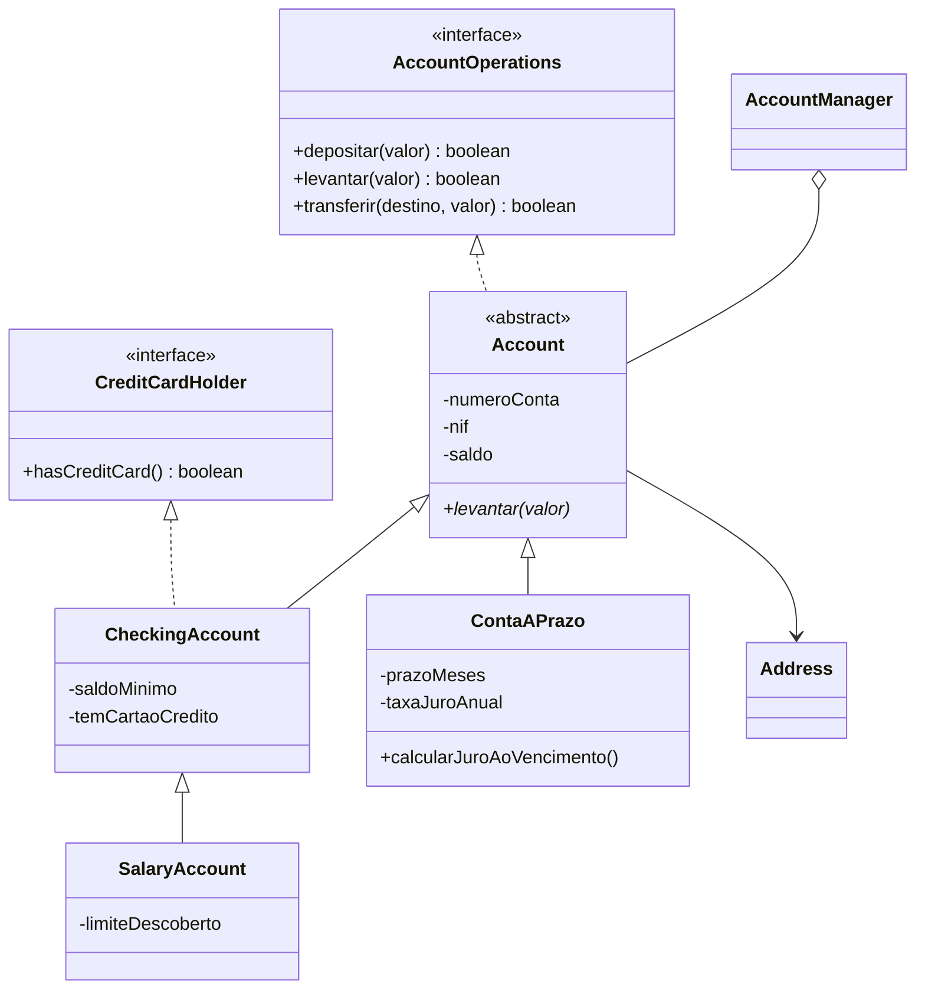

# Gestor de Contas Bancárias (Java)

Aplicação de desktop (Java + Swing) para gerir contas bancárias em memória: criar, consultar, editar e remover contas e fazer depósitos, levantamentos e transferências. O foco do projeto é a **programação orientada a objetos** (herança, classes abstratas, interfaces e polimorfismo).

> Trabalho académico (Licenciatura em Engenharia Informática, ISPGAYA), desenvolvido em dupla com Samuel Gomes. Esta versão inclui uma revisão posterior: dinheiro em `BigDecimal`, validações, testes e correção de bugs (ver abaixo).

## Modelo de classes



Cada tipo de conta redefine a **regra de levantamento** (polimorfismo):

| Conta | Regra |
|---|---|
| `CheckingAccount` (à ordem) | O saldo final não pode ficar abaixo do saldo mínimo |
| `SalaryAccount` (salário) | Pode ficar negativa até ao limite de descoberto |
| `ContaAPrazo` | Só permite levantar depois do vencimento (depósito mínimo de 500 €) |

## Como correr

Requisitos: **JDK 17+**.

```bash
# com Maven
mvn test                      # corre os testes
mvn package && java -jar target/gestor-contas-bancarias-1.0.0.jar

# sem Maven
mkdir out && javac -d out src/main/java/contas/*.java
java -cp out contas.GestorContasApp
```

## Testes

`src/test/java/contas/ContasTest.java` (JUnit 5, 15 testes) cobre validações (NIF, código postal, idade), exatidão do dinheiro, as três regras de levantamento, duplicados no gestor, transferências (incluindo as recusadas, que não podem alterar saldos) e edição com dados inválidos.

## O que foi melhorado após a entrega

| Antes | Depois |
|---|---|
| Dinheiro em `double` (`0.1 + 0.2 != 0.3`) | `BigDecimal` com 2 casas decimais |
| NIF guardado como `int` sem validação; data de nascimento como `String` | NIF validado (9 dígitos + dígito de controlo) e `LocalDate` com verificação de maioridade |
| O construtor de `Address` não validava o código postal (só o *setter*) | Validação em todos os campos, na construção e nos *setters* |
| Prazo pedido em **meses** mas guardado e mostrado como **dias** | Prazo em meses, com data de vencimento calculada |
| `ContaAPrazo.levantar` permitia levantar a qualquer momento (o comentário dizia o contrário) | Só após o vencimento; método `calcularJuroAoVencimento()` |
| `saldo` `protected` (qualquer subclasse o alterava) | Saldo privado, alterado apenas por `creditar`/`debitar` |
| Números de conta duplicados e transferência para a própria conta | Recusados; gestor com `Map` (pesquisa direta) |
| Edição de morada podia ficar a meio (campos alterados antes de falhar) | Valida primeiro, altera depois |
| "PIN" aleatório mostrado e descartado (`Math.random`, sem uso) | Removido |
| Interfaces dentro de outros ficheiros; lógica de GUI misturada | Um ficheiro por tipo; GUI só interação, regras no domínio |

## Limitações

- Os dados vivem em memória (perdem-se ao fechar). Um próximo passo natural é persistir em ficheiro/SQLite.
- Não há autenticação nem histórico de movimentos.
